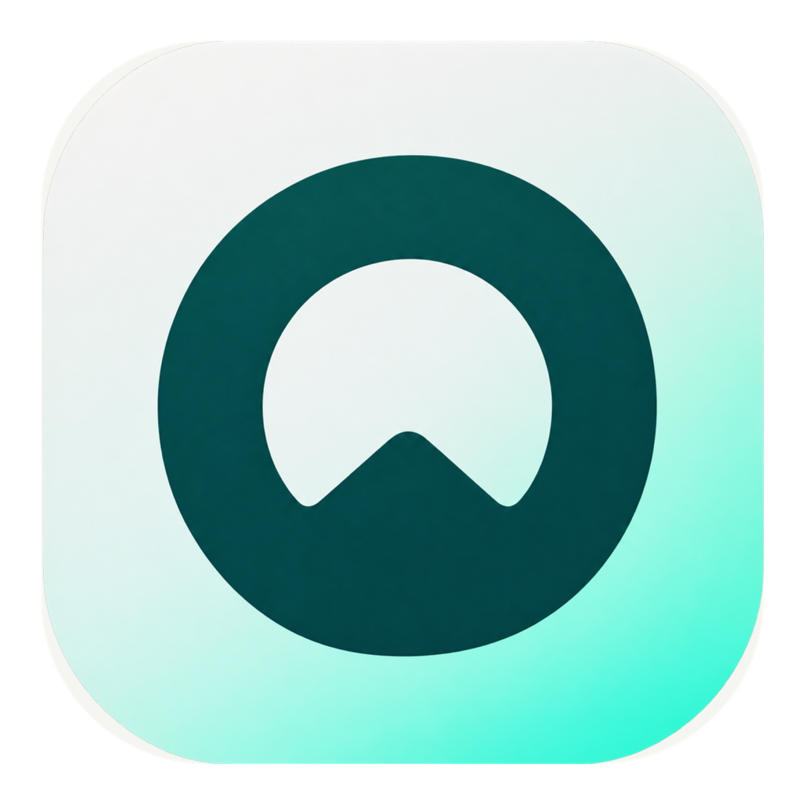

# OrbisPeek

**Press Space. See more.**

English · [简体中文](README.zh-CN.md)

A lightweight, open-source macOS Quick Look extension. Select a document in Finder and press Space to preview Markdown, JSON / JSONL, configuration files, logs and source code. The host app provides an introduction, folder-permission management and an optional extensionless-text preview switch.

OrbisPeek uses a native Swift host and Quick Look extension, a bounded text loader, and a shared WKWebView renderer. It runs on macOS 15 or newer and ships without Node or Electron.

The project was previously named Quicklook. Internal module names, bundle identifiers and resource protocols retain that name for compatibility.

## Status and formats

This is a development preview. Local Swift and JavaScript checks, signed Universal packaging, installation and core preview flows have been exercised on macOS 27.0.1 / Xcode 27.2 / Apple Silicon. Other macOS versions, Intel hardware, reboot recovery and notarized distribution remain unverified. The current local package has not been submitted for notarization.

The [type registry](docs/file-types.md) recognizes **230 suffixes, 87 format groups and 56 filename rules**. These counts describe recognition, not a claim that every suffix has passed Finder acceptance. Actual routing depends on macOS UTTypes and other installed Quick Look providers.

- Markdown: tables, task lists, highlighted code blocks, rendered / source views, and local images including bounded `` width/height attributes.
- HTML / HTM / XHTML keep the system preview. Build 1225 removes OrbisPeek's HTML preview declarations; shared HTML rendering code remains without a current product entry point.
- JSON: formatting preserves large integers, duplicate keys, key order and original escapes; invalid JSON falls back to source.
- JSONL / NDJSON: bounded row previews with invalid rows retained and identified.
- YAML, TOML, properties, INI, logs and common source languages: syntax highlighting.
- Existing supported formats use BOM-aware Unicode loading and best-effort legacy encodings; long lines, display rows and resource sizes are bounded.
- **Extensionless text preview is off by default.** Enable it on the app page to attempt read-only text for files whose actual type is directly `public.data`, mainly extensionless files. Close and reopen the preview after changing the switch. It accepts strict UTF-8 or explicit UTF-16/32 BOMs without guessing legacy encodings. Loading-stage rejection restores the system icon/metadata presentation, without guaranteeing content rendering by another provider.
- Light / dark appearance, wrapping, line numbers and selected plain-text copying. A compact toolbar provides mode and wrap icons.

TXT, PDF and Office documents continue to use native macOS preview capabilities. OrbisPeek does not change default opening applications or include a separate Office rendering engine.

Signed build **0.1.1 (1226)** is installed. Its single app page now contains the logo, name, slogan, folder management and one compact **Extensionless text preview** switch. Missing or invalid settings keep it off; users upgrading from 1225 are not automatically opted in. The same Finder file passed off → on → off checks, and the setting persisted across app restarts and continued working after the app quit. Enabled binary rejection, disabled-state Markdown rendered/source views and system HTML passed. All 96 Swift checks, including six new preference tests, and eight offscreen layout checks passed. The final setting is off. See [opt-in acceptance](docs/extensionless-opt-in-validation-2026-11-15.md). Find, Open With and File → Open / ⌘O remain removed, with no new background helper or permissions; this round did not repeat Finder clipboard acceptance.

The build notes below are historical acceptance records. Their former dedicated-reader entry points are superseded by the preview-only scope; [input and routing results](docs/preview-interface-validation-2026-11-12.md) remain recorded without being reclassified as successes.

Build 1225 introduced unclassified-text attempts without a switch. Its 19-file / 20-state Finder acceptance covered Unicode text, empty and bounded large-file content, loading-stage rejection, same-path text-to-binary changes and native-format controls. Build 1226 replaces that unconditional behavior with explicit opt-in. The **194 declarations remain static: 193 semantic types plus direct `public.data`**; the disabled feature returns to the system at runtime without reading the document body. See the [historical unclassified-text validation](docs/unclassified-text-validation-2026-11-15.md).

Build 1220 was built and installed with Open With and File → Open / ⌘O document-reader entry points removed. Actual menu, Finder Open With and Markdown render/source/wrap checks passed. Find remained removed, no background helper was added, and default applications for seven fixtures were unchanged. That build retained two HTML declarations within its 195-type list, but fresh HTML/HTM/valid XHTML files still used the system preview in Finder. See [1220 acceptance and outstanding work](docs/preview-plugin-only-validation-2026-11-15.md) and the [current feature inventory](docs/app-features-2026-11-14.md).

Build 1208 fixes the Finder Copy responder recursion. On 2026-11-14, selected-text ⌘C, plain-text output and actual pasting passed in rendered and source views. The inner toolbar no longer repeats the filename; metadata and mode/wrap icons remain. See the [repair acceptance](docs/finder-copy-repair-2026-11-14.md), [original 1207 failure](docs/finder-copy-validation-2026-11-14.md) and [current feature inventory](docs/app-features-2026-11-14.md).

Build 1209 adds controlled Markdown `` support. Finder image display, the README's 96px size, source toggling and selected plain-text copying/pasting passed with a synthetic folder grant; the temporary grant was then revoked. See [image acceptance and scope](docs/markdown-img-validation-2026-11-14.md).

Build 1214 simplifies the host to an introduction and folder management page. Its empty state guides first use; unreadable local images show a compact permission entry. The dedicated reader opens the management page directly. On this Mac, Finder's public opening API returns failure, so the preview displays manual setup steps. Adding and individually removing a test folder passed while preserving existing grants. See [onboarding acceptance](docs/permission-onboarding-validation-2026-11-14.md).

Build 1218 defaults first-use folder selection to the account's real home directory and keeps a separate other-folder choice. Native sheet confirmation, both cancellation paths, persistence after reopening, and Finder image/source round trips passed. No background helper was added. See [home-folder acceptance](docs/home-directory-onboarding-validation-2026-11-14.md).

Build 1219 excludes line numbers from native text selection in numbered views. Actual WebKit checks and Finder drag/select-all acceptance passed; plain-text copy projection is preserved. See [selection repair](docs/line-number-selection-validation-2026-11-14.md).

All **227 suffixes were individually inspected in Finder** on macOS 27.0.1 / Apple Silicon with version **0.1.1 (12)** on 2026-11-11, before the rename. Actual document content was visible for **223**: 220 through Quicklook and 3 through the native text preview. There were no uninspected cases or unexpected failures.

Four text samples — **`.ts`, `.mts`, `.edn`, `.exs`** — showed file metadata rather than content. These suffixes conflict with video, Adobe data or Logic instruments. The maintainer explicitly chose to preserve those system formats; these cases remain recorded as failures with accepted compatibility limitations, and are never counted as content passes. See the [complete 227-row report](docs/finder-coverage.md), [machine-readable results](docs/finder-coverage.json) and [explicit boundary policy](samples/coverage/accepted-limitations.json).

The [coverage corpus](samples/coverage/README.md) uses representative syntax samples, not private user documents or a claim to validate every content variant. [Reporting rules](docs/finder-coverage-reporting.md) separate actual Finder evidence, type registration, missing observations and accepted limitations. Earlier [local acceptance results](docs/beta-validation-2026-11-11.md) cover installation, directory permissions and rollback.

## Build and run

Requirements: macOS 15+, Xcode 16+ with Swift tools 6.0+, XcodeGen, Python 3.11+ for the full test suite, and Node 24.

```sh
./scripts/build
```

The script installs locked npm dependencies, generates type declarations and the Xcode project, and builds `.build/xcode/Build/Products/Debug/OrbisPeek.app` with local ad-hoc signing. No Apple developer account is needed for this basic build.

Open the host, then enable OrbisPeek Preview in **System Settings → General → Login Items & Extensions → Quick Look**. Review competing providers if Finder displays another plugin's preview. The main page contains the introduction, folder management and optional extensionless-text preview switch. Earlier sample checks and diagnostic UI are removed; developer validation tools remain available.

For build-only work, `./scripts/build --no-register` removes only that build's registration after success. Xcode still briefly registers the output during the build.

## Test and inspect coverage

```sh
npm --prefix WebRenderer ci --no-audit --no-fund
./scripts/test
python3 -m unittest discover -s Tests/Acceptance -p 'test_*.py' -v
python3 scripts/make-coverage-fixtures.py --output .build/finder-coverage-preview-interface
```

Automated tests cover generated declarations, Swift loading and policy logic, JavaScript rendering, and Python acceptance helpers. Generating fixtures does not open Finder or prove preview coverage. [CI](.github/workflows/ci.yml) also rebuilds generated resources and compiles a Universal app with ad-hoc signing; it does not publish or notarize packages.

For actual WebKit rendering, large-file checks and UTType inspection, follow the [validation plan](docs/validation-plan.md) and [core results](docs/validation-results.md). Route matching, an open Quick Look window and visible document content are separate evidence.

The full suffix check above does not cover all filename-only rules, dotfiles, encodings, file sizes or macOS versions. Those surfaces still require separate verification; recognition alone cannot guarantee Finder dispatch when macOS assigns a broad generic type.

The optional text fallback applies only when enabled and the actual type is directly `public.data`; extensionless files and dotfiles with other types are not guaranteed to enter it. Arbitrary unknown suffixes typically have `dyn.*` types and did not match `public.data`, `public.item` or `public.content` ancestry in the isolated tests. Production does not enumerate the experimental dynamic identifier or claim all unknown extensions or cross-version fallback behavior. A versioned shared settings file is read for every new request, with a 4 KiB limit and atomic writes; missing or invalid data defaults to off. Shared settings require the signed App Group build, and the switch is unavailable without that configuration.

System icon/metadata fallback is limited to loading-stage rejection on a first or reopened preview; it does not establish chaining to another content provider. Asynchronous WebKit failures still use the app's error view. If a file becomes unreadable while the preview is hidden and then resumes, the preview asks the user to close it and press Space again; reopening reapplies the strict text policy. Other operating systems, Intel and reboot recovery are not accepted by this local run.

## Local images and security

Document-provided scripts are not executed, and document rendering does not automatically request network resources. Local images are restricted to bounded raster files within the allowed document directory; remote URLs, absolute paths, parent traversal, escaping symlinks and SVG are rejected.

Quick Look normally grants access to the previewed file alone. For local Markdown images, build with your own existing Developer ID and App Group, then grant a read-only folder through the host:

```sh
QUICKLOOK_SIGNING_IDENTITY='Developer ID Application: Your Name (TEAMID)' \
QUICKLOOK_TEAM_ID='TEAMID' \
./scripts/build --directory-access
```

First-use setup offers read-only access to your personal folder, with the system picker initially positioned at your account's home directory. Confirm the folder once, or use **Choose another folder** for a project or notes folder containing both documents and their images. Existing users can find both choices under ＋; the corresponding − removes one grant. Close and reopen existing previews after changing access. The host need not remain open after the extension receives the grant. This does not bypass macOS protection for private app data. See [local image access](docs/local-image-access.md) and the [home-folder acceptance](docs/home-directory-onboarding-validation-2026-11-14.md); no full-disk temporary exception or background helper is used.

Report vulnerabilities using [SECURITY.md](SECURITY.md). Share synthetic samples and review diagnostic exports before uploading them.

## Release packaging

```sh
QUICKLOOK_SIGNING_IDENTITY='Developer ID Application: Your Name (TEAMID)' \
QUICKLOOK_TEAM_ID='TEAMID' \
./scripts/package-release

./scripts/verify-release dist/release/OrbisPeek-0.1.1-macos-universal.manifest.json
```

This builds a Developer ID signed `arm64 + x86_64` Release app and produces ZIP, DMG, SHA-256 and manifest files. Packaging verifies signatures, entitlements, licenses and the unpacked app tree. Signing credentials stay outside the repository. Notarization requires a separate explicit option; ordinary packaging does not upload to Apple.

Universal compilation is not an Intel runtime test. See the [release and rollback guide](docs/releasing.md) and [installation acceptance plan](docs/beta-acceptance.md) before distribution.

## Contributing and licenses

Project: [Kairan-Peng/OrbisPeek](https://github.com/Kairan-Peng/OrbisPeek). See [CONTRIBUTING.md](CONTRIBUTING.md), the [Code of Conduct](CODE_OF_CONDUCT.md) and [CHANGELOG.md](CHANGELOG.md).

OrbisPeek's code is [MIT licensed](LICENSE). It adapts MIT code from FreeLook and QLStephenSwift and uses markdown-it, highlight.js and jsonc-parser. Upstream licenses remain intact and ship with both bundles. Exact source revisions, modifications and runtime dependency licenses are recorded in [THIRD_PARTY_NOTICES.md](THIRD_PARTY_NOTICES.md) and the [renderer notices](WebRenderer/THIRD_PARTY.md).
